<a href="https://github.com/meulencv">English</a>&ensp;·&ensp;<b>Español</b>&ensp;·&ensp;<a href="https://github.com/meulencv/meulencv/blob/main/README.ca.md">Català</a>

<picture>
  <source media="(prefers-color-scheme: dark)" srcset="assets/es/hero-dark.svg">
  
</picture>

 

[Descubre Meulify ›](https://meulify.top)&emsp;[TechnologiesCV ›](https://technologiescv.com)&emsp;[LinkedIn ›](https://www.linkedin.com/in/meulen-cirillo-veltri/)&emsp;[Discord ›](https://discord.gg/eFCr4vxDt3)

  

<picture>
  <source media="(prefers-color-scheme: dark)" srcset="assets/es/hacks-dark.svg">
  
</picture>

  

<picture>
  <source media="(prefers-color-scheme: dark)" srcset="assets/es/awards-dark.svg">
  
</picture>

 

Por la cabra, para cabras.
