<b>English</b>&ensp;·&ensp;<a href="https://github.com/meulencv/meulencv/blob/main/README.es.md">Español</a>&ensp;·&ensp;<a href="https://github.com/meulencv/meulencv/blob/main/README.ca.md">Català</a>

<picture>
  <source media="(prefers-color-scheme: dark)" srcset="assets/en/hero-dark.svg">
  
</picture>

 

[Discover Meulify ›](https://meulify.top)&emsp;[TechnologiesCV ›](https://technologiescv.com)&emsp;[LinkedIn ›](https://www.linkedin.com/in/meulen-cirillo-veltri/)&emsp;[Discord ›](https://discord.gg/eFCr4vxDt3)

  

<picture>
  <source media="(prefers-color-scheme: dark)" srcset="assets/en/hacks-dark.svg">
  
</picture>

  

<picture>
  <source media="(prefers-color-scheme: dark)" srcset="assets/en/awards-dark.svg">
  
</picture>

 

By a GOAT, for GOATs.
